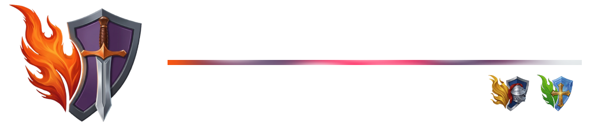
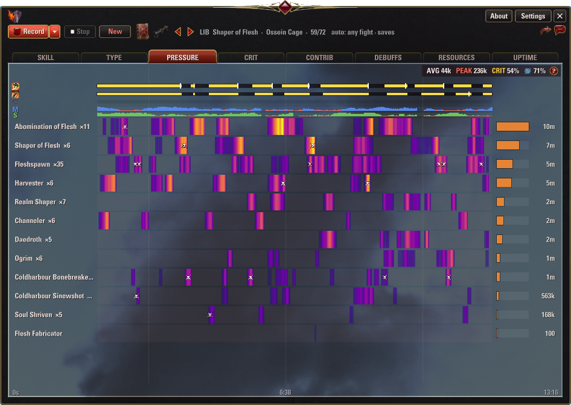
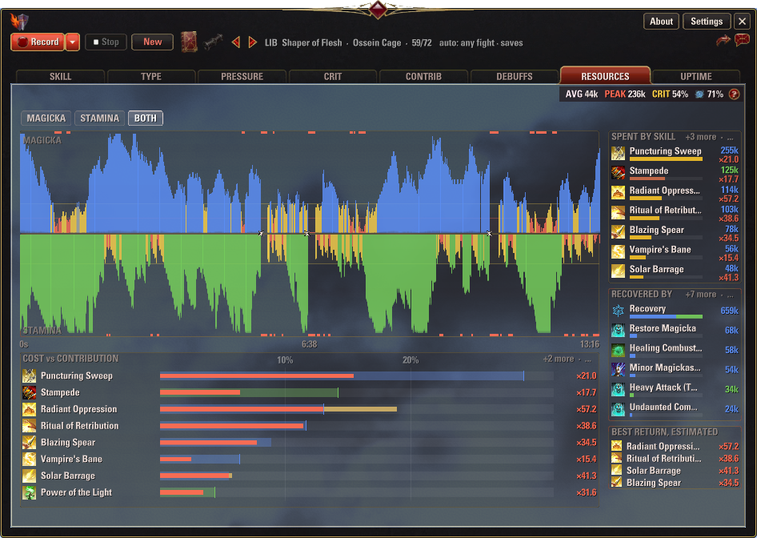
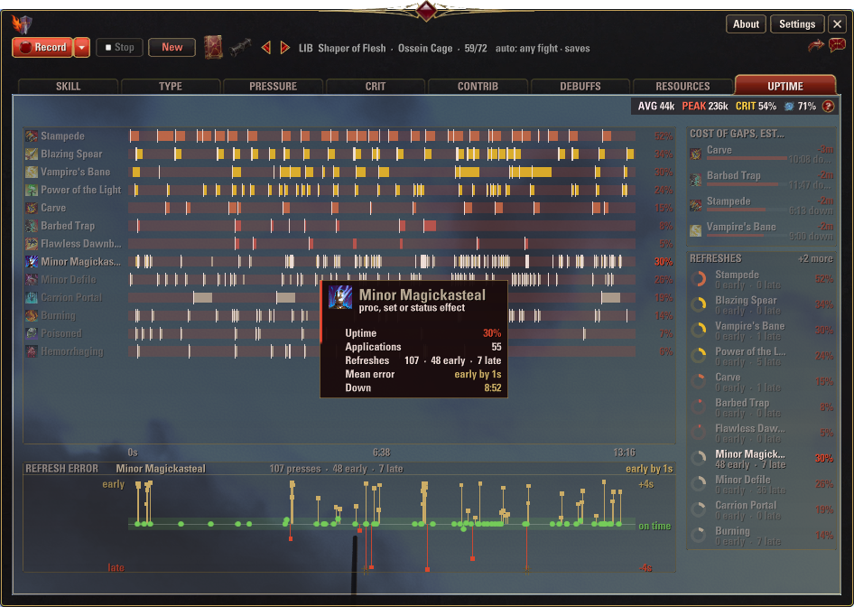

# Vermilion

This software unit is mainly a damage analytic tool for the video game _The Elder Scrolls Online_.

It records what your damage did during a fight and lets you read it afterwards. What each skill did, on whom, what it cost, and a couple of other things.

## In-game

<video controls src="docs/nav_16x9_prueba.mp4" title="Title"></video>

## Install

Download from [ESOUI](https://www.esoui.com/downloads/info4616-Vermilion.html), or from the releases of this repository, and extract into `Documents/Elder Scrolls Online/live/AddOns/`.

Vermilion has no dependencies.

___

_This Add-on is not created by, affiliated with, or sponsored by ZeniMax Media Inc. or its affiliates. The Elder Scrolls® and related logos are registered trademarks or trademarks of ZeniMax Media Inc. in the United States and/or other countries. All rights reserved._
